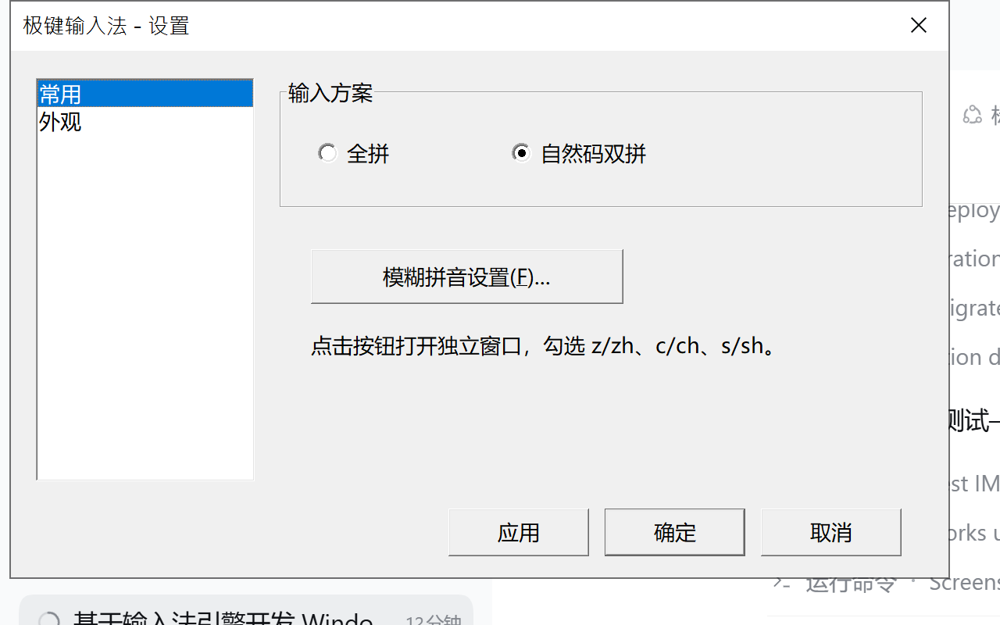
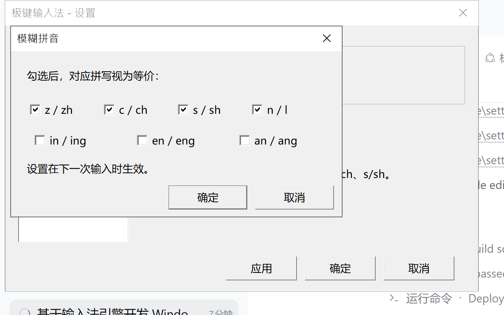
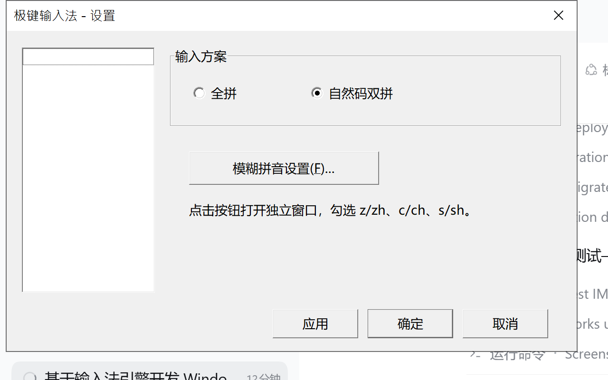

# 极键输入法（Windows x86_64 TSF）

以本仓库的 `libgooglepinyin` 为拼音内核实现的 Windows 64 位输入法。
输入法以 TSF（Text Services Framework）Text Service 的形式注入到应用程序，
自带候选窗口，使用 Visual Studio 2019（v142，x64）编译。

## 代码阅读

源码里已经加了中文注释。建议先看 [CODE_GUIDE.md](CODE_GUIDE.md)：里面按
“TSF 概念 → 阅读顺序 → 关键流程 → 想改功能看哪里”的顺序整理了整个输入法。

## 目录

```
winime/
├─ GikGinIME.sln          VS2019 解决方案
├─ GikGinIME.vcxproj      TSF 输入法 DLL
├─ gikgin_core.vcxproj    libgooglepinyin 静态库
├─ dictbuilder.vcxproj          词典生成工具
├─ engine_test.vcxproj          内核测试程序
├─ tsf_host.vcxproj             端到端测试宿主（EDIT 控件）
├─ settings.vcxproj             设置界面 EXE
├─ replace-ime-dll.bat          替换被占用 DLL 的一键脚本
├─ sign-binaries.bat            给发布文件加数字签名
├─ scripts/                     脚本源码（replace-ime-dll.ps1、sign-binaries.ps1）
├─ src/                         输入法源码（含中文注释）
├─ settings/                    设置界面的对话框资源
├─ data/dict_pinyin.dat         已生成好的系统词典（x64）
├─ dist/                        可直接安装的发布目录
│  ├─ switch-to-ziranma.bat     设置失败时的自然码切换脚本
│  └─ switch-to-full.bat        设置失败时的全拼切换脚本
├─ test/                        测试源码
└─ CODE_GUIDE.md                代码阅读指南
```

## 编译

要求：

- Windows 10/11 x64
- Visual Studio 2019，安装“使用 C++ 的桌面开发”
- Windows 10 SDK（项目使用 `10.0`，自动选择已安装版本）

打开 `winime\GikGinIME.sln`，选择 `Release | x64`，生成解决方案。
也可以使用命令行：

```bat
msbuild winime\GikGinIME.sln /m /p:Configuration=Release /p:Platform=x64
```

输出在 `winime\build\x64\Release\`，其中：

- `GikGinIME.dll`：输入法
- `GikGinIMESettings.exe`：设置界面（全拼 / 自然码双拼）
- `dict_pinyin.dat`：系统词典（构建时自动复制到 DLL 旁边）
- `engine_test.exe`、`tsf_host.exe`：测试程序
- `dictbuilder.exe`：词典生成工具

`dict_pinyin.dat` 已经随仓库提供，普通编译不需要重新生成。如果需要重新生成：

```bat
winime\build\x64\Release\dictbuilder.exe ^
  data\rawdict_utf16_65105_freq.txt ^
  data\valid_utf16.txt ^
  winime\data\dict_pinyin.dat
```

> 词典格式包含 `size_t` 字段，因此必须用 x64 版 dictbuilder 生成，并由 x64 版
> 输入法加载。

## 替换 DLL 时提示“文件被占用”

TSF 输入法 DLL 被应用加载后不能直接覆盖。双击运行：

```text
winime\replace-ime-dll.bat
```

脚本会：

1. 结束并重启资源管理器（最常见的占用者）；
2. 尝试用 `build\x64\Release\GikGinIME.dll` 覆盖 `dist\GikGinIME.dll`；
3. 如果仍被其他程序占用，就把旧 DLL 改名到 `build\locked\`，再复制新 DLL；
4. 顺手更新 `dist\GikGinIMESettings.exe`。

默认不会结束浏览器、IDE 或当前 Agent 进程，避免丢失未保存内容。如果确实需要
强制结束其他占用程序：

```bat
replace-ime-dll.bat -KillAll
```

只想替换文件、不想重启资源管理器：

```bat
replace-ime-dll.bat -NoExplorerRestart
```

替换完成后，**已经打开的程序仍然使用旧 DLL**，需要重启这些程序（或重启系统）
才能用上新版本。

## 数字签名

Windows 的“数字签名”指 Authenticode 签名，需要先有**代码签名证书**，
不是用工具随便生成一个就能被其他电脑信任。

- **正式发布**：向 CA（DigiCert、Sectigo、GlobalSign 等）购买
  OV 或 EV Code Signing 证书。EV 证书通常放在硬件令牌/云签名服务里，
  私钥不能导出。
- **本机测试**：可以创建自签名证书，但只在本机（并且把证书装进
  “受信任的根证书颁发机构/受信任的发布者”）才显示为可信，
  不要拿自签名文件对外发布。

### 给 dist 里的文件签名

先构建 Release，然后运行：

```bat
:: 使用 PFX 文件
sign-binaries.bat -PfxPath C:\certs\codesign.pfx -Password 你的密码

:: 或使用证书存储里的证书（EV 令牌常用）
sign-binaries.bat -Thumbprint 0123456789ABCDEF0123456789ABCDEF01234567
```

脚本会：

1. 找到 Windows SDK 的 `signtool.exe`；
2. 对 `dist\GikGinIME.dll` 和 `dist\GikGinIMESettings.exe`
   使用 SHA-256 签名；
3. 使用 `http://timestamp.digicert.com` 加时间戳；
4. 用 `signtool verify /pa /v` 验证。

其他参数：

```bat
sign-binaries.bat -Thumbprint ... -MachineStore
sign-binaries.bat -PfxPath ... -Password ... -TimestampUrl http://timestamp.sectigo.com
sign-binaries.bat -PfxPath ... -SigntoolPath "C:\...\signtool.exe"
```

签名后再打包 ZIP。**签名后不要再修改 DLL/EXE**，否则签名失效。
ZIP 本身不能做 Authenticode 签名；可以另外提供 ZIP 的 SHA-256 校验值。

### 本机测试用自签名证书

在 PowerShell 中执行（只用于本机测试）：

```powershell
$cert = New-SelfSignedCertificate `
  -Type CodeSigningCert `
  -Subject "CN=GikGinIME Test" `
  -CertStoreLocation Cert:\CurrentUser\My `
  -HashAlgorithm SHA256

$pwd = ConvertTo-SecureString "test123" -Force -AsPlainText
Export-PfxCertificate -Cert $cert -FilePath .\test-codesign.pfx -Password $pwd
Export-Certificate -Cert $cert -FilePath .\test-codesign.cer

# 让本机信任这个测试证书
Import-Certificate -FilePath .\test-codesign.cer -CertStoreLocation Cert:\CurrentUser\Root
Import-Certificate -FilePath .\test-codesign.cer -CertStoreLocation Cert:\CurrentUser\TrustedPublisher
```

然后：

```bat
sign-binaries.bat -PfxPath .\test-codesign.pfx -Password test123
```

> 自签名只适合验证签名流程。其他电脑没有安装这张证书时，仍会显示
> “未知发布者”；Windows SmartScreen 也需要正式证书和一定的下载信誉。

## 安装

最简单的方式：把 `winime\dist\` 整个目录复制到任意固定位置（路径建议不要包含
特殊字符），右键以管理员身份运行 `install.bat`。

安装脚本会：

1. 用 64 位 `regsvr32` 注册 COM 进程内组件；
2. 在 TSF 中注册语言配置（中文简体，`0x0804`）和键盘输入法类别；
3. 启用配置并加入当前用户的键盘列表。

安装后在：

`设置 → 时间和语言 → 语言 → 中文(简体) → 选项 → 添加键盘`

中选择“极键输入法”，然后按 `Win + Space` 切换。

卸载：以管理员身份运行 `dist\uninstall.bat`，或：

```bat
regsvr32 /u /s "完整路径\GikGinIME.dll"
```

## 使用

| 按键 | 功能 |
| --- | --- |
| 字母 | 输入拼音 |
| 空格 | 提交当前候选（默认第一个） |
| 数字 1–9、0 | 选择当前页第 1–10 个候选 |
| ↑ / ↓ / ← / → | 移动候选选择 |
| PgUp / PgDn | 候选翻页 |
| Tab | 下一个候选 |
| 退格 | 删除一个拼音字母 |
| 回车 | 提交当前拼音（不转换） |
| Esc | 取消本次输入 |
| Shift | 中英文切换（松开 Shift 后生效） |
| 鼠标点击候选 | 选择候选 |

中文标点：`,`→`，`、`.`→`。`、`;`→`；`、`!`→`！`、`?`→`？`、
`[`→`【`、`]`→`】`、`\`→`、`，`1`（Shift）→`！`，`9`/`0`（Shift）→`（）`。

候选窗口不会抢焦点；点击候选后继续输入。

## 设置与自然码双拼

两种打开设置的方式：

1. 在候选窗口右上角点击“设置”；
2. 直接运行 `dist\GikGinIMESettings.exe`。

设置界面左侧有“常用”和“外观”两个页面：

- **常用**：输入方案（全拼 / 自然码双拼）+“模糊拼音设置...”按钮。
  点击按钮会弹出一个**独立的模糊拼音窗口**，里面两排共七个选项：
  声母 `z/zh`、`c/ch`、`s/sh`、`n/l`，韵母 `in/ing`、`en/eng`、`an/ang`；
  点确定写回内存，再由主窗口的“应用/确定”统一保存
  （点主窗口“取消”可放弃全部修改）。
- **外观**：每页候选数（5、7、9、10、15、20、25）、
  字体大小（14～28）、候选词间隔（0～12 像素，行距、列距同时生效）







点“应用”保存但不关闭；点“确定”保存并关闭，**下一次开始输入时生效**。
普通情况下写入 `HKCU\Software\GikGinIME`；如果设置程序被沙箱限制为
低完整性，会自动把设置写到 `%USERPROFILE%\AppData\LocalLow\GikGinIME\settings.ini`，
输入法会读取较新的那一份，所以从候选窗口打开设置也能保存。

如果设置程序仍然提示“保存设置失败”，可以直接运行：

```text
switch-to-ziranma.bat   切换到自然码
switch-to-full.bat      切换到全拼
```

这两个脚本优先调用设置程序的命令行模式，失败时才回退到 `reg.exe`。
也可以手动执行：

```bat
GikGinIMESettings.exe --ziranma
GikGinIMESettings.exe --full
```

> 模糊拼音的实现方式是把启用规则对应的所有拼写变体都搜索一遍，
> 合并候选：声母规则（z/zh 等）少打 h 时优先试补全，
> 韵母规则（in/ing 等）和 n/l 互换则**精确输入排第一**、模糊候选穿插在后面。
> 模糊模式下选词会直接提交整词，不做“先选一个字再继续”的部分选词；
> 需要逐字选词时关闭模糊拼音即可。

自然码双拼每个音节两个键，`zh/ch/sh` 分别用 `v/i/u`。
例如：

| 想输入 | 自然码按键 | 说明 |
| --- | --- | --- |
| 你好 | `nihk` | ni + hk（hao 的韵母 ao 在 k） |
| 中国 | `vsgo` | zhong=vs（zh=v, ong=s），guo=go |
| 北京 | `bzjy` | bei=bz（ei=z），jing=jy（ing=y） |
| 我们 | `womf` | wo=wo，men=mf（en=f） |
| 桌 | `vo` | zhuo=vo（zh=v, uo=o） |
| 女 | `nv` | nü 用 v |
| 卷 | `jr` | juan=jr（uan=r） |

零声母（a/o/e 开头）：
`aa`/`oa`=a，`oo`=o，`ee`/`oe`=e，
`ai`/`ol`=ai，`ei`/`oz`=ei，`ao`/`ok`=ao，`ou`/`ob`=ou，
`an`/`oj`=an，`en`/`of`=en，`er`/`or`=er，
`ah`/`oh`=ang，`eg`/`og`=eng。

## 实现说明

- `src/gikgin_ime.cpp`：TSF Text Service，实现
  `ITfTextInputProcessorEx`、`ITfThreadMgrEventSink`、`ITfKeyEventSink`、
  `ITfCompositionSink`、`ITfDisplayAttributeProvider`。
- `src/engine.cpp`：对 `libgooglepinyin` C API 的封装；每个 UI 线程使用独立
  解码器（`pinyinime.cpp` 中使用 `thread_local`）。
- `src/candidate_window.cpp`：GDI 绘制的无焦点候选窗口，支持鼠标点击。
- `src/dllmain.cpp`：COM 类工厂、`DllRegisterServer` /
  `DllUnregisterServer`、TSF 语言配置注册。
- `src/display_attribute.cpp`：组合串的虚线下划线显示属性。
- `src/edit_session.h`：同步 `ITfEditSession` 封装。
- `src/shuangpin.cpp`：自然码双拼 -> 全拼转换。
- `src/settings.cpp` / `settings/main.cpp`：设置读写和对话框。

对上游 `libgooglepinyin` 的修改：

- 新增 `include/win32_compat.h`、`src/win32_compat.cpp`：MSVC 下的
  pthread/gettimeofday/UTF-8 文件路径兼容层。
- `src/userdict.cpp`：Windows 下使用二进制文件 I/O，避免文本模式破坏词典。
- `src/pinyinime.cpp`：Windows 下把解码器状态改为 `thread_local`。
- 新增 `im_get_composing_text()`：返回“已固定的汉字 + 剩余拼音”，用于组合串。
- 删除 `tools/pinyinime_dictbuilder.cpp` 中对 `<unistd.h>` 的依赖。

## 限制

- 只提供 **x86_64** 版本，只能用于 64 位应用程序；没有 32 位 DLL。
- 只支持 TSF 输入；不支持 IMM32-only 的老程序。
- 候选窗口为自绘窗口，没有实现 `ITfCandidateListUIElement` 原生候选 UI。
- 未实现云输入、皮肤、词库导入导出、自造词管理等高级功能。
- 用户词典保存在
  `%LOCALAPPDATA%\GikGinIME\userdict.dat`，退出输入法时写回。

## 注册信息

- CLSID：`{AB5DAAB8-9596-4049-BD8C-3EB11D3076B3}`
- 语言配置 GUID：`{A012A434-1BC8-4DAF-9E3F-F4A916798BAD}`
- 显示属性 GUID：`{10ED3921-86D5-4219-B739-35A6E30D95D4}`
- 语言：`0x0804`（中文简体）
